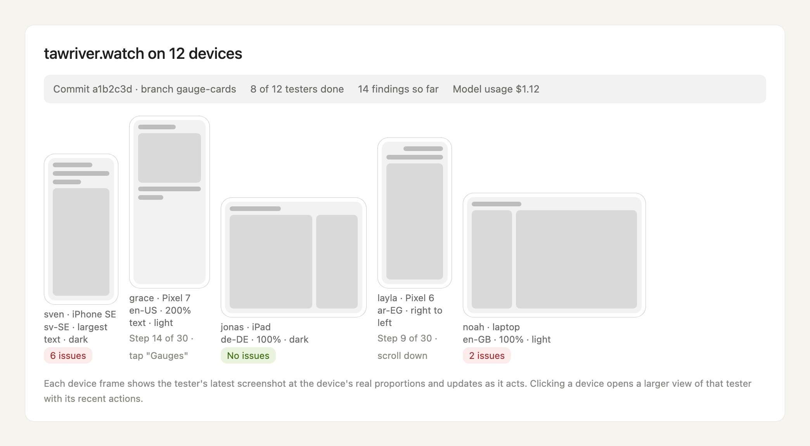

# Footfall

<picture>
  <source media="(prefers-color-scheme: dark)" srcset="docs/images/mockups/live-run-device-wall-dark.png">
  
</picture>

*A mockup of the live device wall.*

Coding agents now build and change web apps in minutes. But most of the code they write is never read by a person. While tests check what the app is expected to do they won't show whether someone with their text at its largest can still sign up on a small phone, or whether the arrows point the right way for someone who reads Arabic.

Developers have always found those problems by watching someone use the app. The cheapest version is hallway testing. You grab whoever is walking past, hand them your phone and watch where they get stuck. Larger teams pay for QA, usability studies and beta testers. All of it assumes people write the code at the speed people work and that somebody remembers to ask.

Agents don't work that way. They change an app many times a day with nobody watching. Often the app has a single user. There is nobody in the hallway.

Footfall is the hallway. When an agent finishes a change it calls Footfall. Footfall runs the app in a sandbox and sends a dozen AI testers at it. Each one plays a different person on a different phone, tablet or laptop and tries to do what the app is meant to do. They report what went wrong with a screenshot of each problem and the steps to see it again. The agent fixes what they found before anyone else looks.

Footfall is open source and self-hosted. You run it on your own server with your own Anthropic API key.

## How it works

The agent asks Footfall over MCP to test its change. Each app's repository holds a brief that says what the app is for and what each kind of person should try to do there. The testers work from that brief. The brief stays the same however often the code is rebuilt.

<picture>
  <source media="(prefers-color-scheme: dark)" srcset="docs/images/diagrams/overview-dark.svg">
  
</picture>

## Status

Footfall is at phase 1 of the [design](docs/design.md). That is the sandbox and the tester. Nothing here is ready to deploy. Phase 1 builds the runner, the gVisor containers, the egress proxy, the browsers, the tester's tools and loop, and a demo app with planted bugs. All of it is driven from the command line. Later phases add runs, deployment, the MCP endpoint and the live device wall.

## Trying phase 1

`footfall test <folder>` sends the testers at an app in a folder on your own machine. You'll need an Anthropic API key and a Linux machine with Docker and gVisor.

Build the images as [images/README.md](images/README.md) describes. Then start the development stack in [deploy/dev/compose.yaml](deploy/dev/compose.yaml) with the commands at the top of that file. The demo app [Tiny Tasks](demo-app/README.md) is a small to-do list with twelve bugs planted for the testers to find. `footfall test /repo/demo-app` tests it.

Docker Desktop on a Mac has no gVisor. To develop on a Mac set `FOOTFALL_RUNTIME=runc`. Footfall then runs the containers under test without gVisor and warns you. Never set it on a server.

## Contributing and security

- [CONTRIBUTING.md](CONTRIBUTING.md) explains how to set up Footfall, run the tests and send a pull request.
- Please report vulnerabilities privately. [SECURITY.md](SECURITY.md) says how.
- Everyone taking part is expected to follow the [code of conduct](CODE_OF_CONDUCT.md).
- [AGENTS.md](AGENTS.md) holds the working rules for AI coding agents.

## Licence

Footfall is published by [Negroni Venture Studios](https://negroniventurestudios.com/) under the [MIT licence](LICENSE). The Footfall name identifies this project. If you ship a fork as your own product please see [TRADEMARKS.md](TRADEMARKS.md). The third-party software and assets Footfall uses are listed in [THIRD_PARTY_LICENCES.md](THIRD_PARTY_LICENCES.md).
